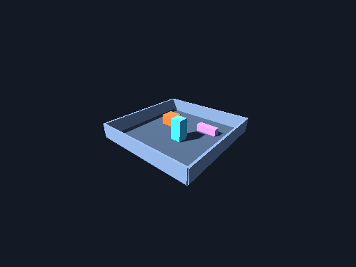

# GodotBridge

Control a live Godot 4 editor from Python, `godotctl`, or an MCP client. Build 3D
scenes with undoable operations, save them through the editor, inspect structured
scene metadata, and capture real images.

**0.1.0 release candidate.** Verified on Windows with Godot **4.7.2 stable**,
Python 3.13.7 and the official MCP Python SDK 2.0.0. Minimum supported engine is
Godot 4.7; Python 3.11+. Linux/macOS support is implemented and has a CI matrix,
but has not been executed in this environment. See [verification and remaining work](PROGRESS.md).



## Quick start

```sh
python -m venv .venv
# Activate .venv using your shell, then:
python -m pip install -e ".[dev]"
godotctl --project examples/3d_demo project install-plugin
godotctl --project examples/3d_demo project open
godotctl --project examples/3d_demo doctor --json
```

The example project already enables the installed plugin. In other projects,
enable **GodotBridge** under **Project → Project Settings → Plugins**. The dock
shows its authenticated loopback endpoint. Credentials stay in the project's
private `.godot/godotbridge` directory; clients discover them automatically.

```sh
godotctl --project examples/3d_demo scene open res://scenes/main.tscn
godotctl --project examples/3d_demo scene tree --json
godotctl --project examples/3d_demo 3d create-box --name Crate --size 2 2 2
godotctl --project examples/3d_demo node position Crate 2 1 0
godotctl --project examples/3d_demo editor undo
godotctl --project examples/3d_demo editor redo
godotctl --project examples/3d_demo scene save
godotctl --project examples/3d_demo scene snapshot --output-dir snapshots/first
```

Build a new floor, four walls, three obstacles, lights, camera, materials and
collision, then validate, reopen and snapshot it:

```sh
python examples/build_arena.py --project examples/3d_demo
```

There is also a [complete CLI workflow](examples/cli-arena.md). Existing scene
and snapshot destinations are not overwritten.

## MCP

Configure a compatible client to launch the installed server over stdio:

```json
{
  "mcpServers": {
    "godotbridge": {
      "command": "/absolute/path/to/.venv/bin/godotbridge-mcp",
      "args": ["--project", "/absolute/path/to/godot-project"]
    }
  }
}
```

On Windows use `.venv\\Scripts\\godotbridge-mcp.exe`. Tools have schemas from
the same Pydantic operation registry used by the CLI and engine validator.
Screenshots are returned as MCP image content and structured artifact metadata.

## Capabilities and boundaries

| Mode | What it provides |
| --- | --- |
| Live editor | Scene/node edits, typed resources, selection, undo/redo, saves |
| Headless editor | The same editing protocol without visible pixels |
| Headless worker | Import, GDScript parsing, resource loading and scene smoke tests |
| Editor screenshot | Pixels from the public editor 3D viewport |
| Auxiliary preview | Isolated geometry/light rendering with configurable viewpoints |
| Managed game | Real running scene, bounded stdout/stderr, lifecycle and runtime PNG |
| Editor play | Public play/stop/status APIs; no captured debugger log stream |

Mutations follow the editor's rules. Inherited-scene nodes accept property and
transform overrides and new children, but cannot be deleted, renamed, reparented
or duplicated. Scene instance roots are editable and `node.instantiate` adds
instances; instance internals need editable children. Non-`@tool` scripted nodes
and their exported variables are editable; `@tool` scripts need `allow_tool_script`.
Preview images omit gameplay, animation, particles, skinning and
the scene's WorldEnvironment. Editor camera transforms are readable; use preview
viewpoints to control framing. See [architecture](docs/architecture.md) and [security](docs/security.md).

## Tests and development

```sh
python -m pytest tests/unit -q
python scripts/run_integration_tests.py
python scripts/run_integration_tests.py --graphical
ruff check python tests scripts examples setup.py
ruff format --check python tests scripts examples setup.py
python -m build
```

Integration tests launch an actual isolated Godot editor and clean up their own
processes. Graphical tests verify PNG dimensions and MCP images; headless tests
verify explicit partial snapshots. They are opt-in when running pytest directly
(`--engine`, `--graphical`). Set `GODOT_EXECUTABLE` if discovery cannot locate your
engine. Regenerate schemas after model changes: `python scripts/sync_schema.py`.

## Documentation

- [Installation and configuration](docs/installation.md)
- [CLI reference](docs/cli-reference.md)
- [MCP reference](docs/mcp-reference.md)
- [Protocol and typed values](docs/protocol.md)
- [Architecture and API references](docs/architecture.md)
- [Security](docs/security.md)
- [Troubleshooting](docs/troubleshooting.md)

MIT licensed. Contributions should include actual engine verification for editor
behavior and state which operating systems and renderers were tested.
