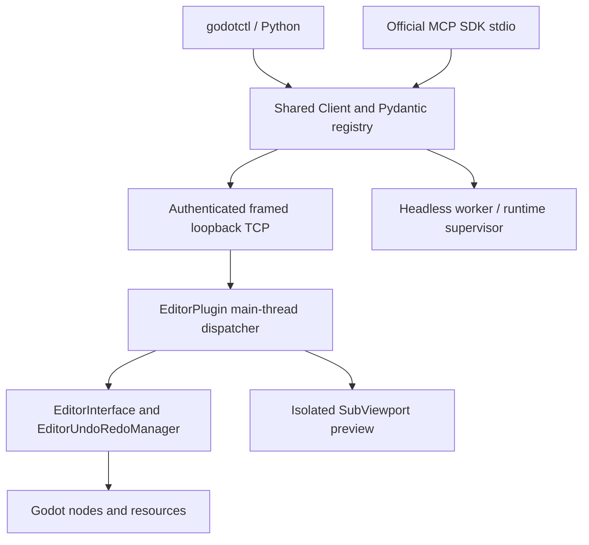

# Architecture

Python and the engine independently validate the shared operation schema. CLI
adapters translate arguments; MCP schemas come directly from the same models.
The editor is authoritative for all live scene mutations.

Polling reads/writes at most 64 KiB per client per frame. Limits: eight clients,
32 queued requests, one active operation. All Godot operations execute on its
main thread. Scene switches and captures yield to the SceneTree. Network reads
never wait for an incomplete frame. A request still running after 120 s
(`REQUEST_WATCHDOG_MS` in `plugin.gd`) is answered `TIMEOUT` (outcome unknown) and the
editor then serves the next request; the abandoned operation may still finish its side
effects later, and if its coroutine resumes it stays silent. A handler script error is
answered `INTERNAL_ERROR` at once. A client has at most one pending request, so the
queue is effectively capped at eight entries by the client limit: the 32-entry
`MAX_QUEUE` check (`EDITOR_BUSY`, "Request queue is full.") cannot be reached in practice.

Node actions use per-scene undo history, explicit ownership, and do/undo references
for lifetime management. Primitive/material/collision creation is one action.
Reparent keeps the global pose for Node3D, Node2D and Control (a Control keeps only its
global position), and undo restores the raw local pose (a Control through
`CanvasItem._edit_get_state`, as `SceneTreeDock` does).
Cross-command transactions are not implemented. Scene creation and saves are
filesystem operations and are not undoable file operations.

Undo/redo accesses the public active-scene history. Godot cautions that direct
history access can affect stability; operations are restricted to the active
scene and rejected during commits. This history includes human editor changes.

Scripts: the editor runs non-`@tool` scripts as placeholder instances (no setters,
`_ready` or `_process`), so those nodes are editable and their exported variables
are listed via `Script.get_script_property_list` (since
placeholders omit `PROPERTY_USAGE_SCRIPT_VARIABLE`). `@tool` scripts really run
and need the per-request `allow_tool_script` opt-in. A script that only extends a `@tool`
script file (no `@tool` of its own) also gets a placeholder instance in the editor, so its
base `_init` does not run (observed on 4.7.2); the bridge still refuses it without the
opt-in, which fails closed. Duplicate uses all `Node.DUPLICATE_*` flags (scripts,
signals, groups, instancing).

Instances: a scene instance is one node owned by the edited root; its internals
are owned by the instance root and `_own` never adopts them, so saved scenes
contain only the instance entry plus overrides. `node.instantiate` uses
`PackedScene.GEN_EDIT_STATE_INSTANCE` with an undoable attach, rejecting self or
transitive recursion via `ResourceLoader.get_dependencies`. The PackedScene is loaded
with `CACHE_MODE_IGNORE`, so the scene's own sub-resources come fresh from disk on every
call (`REUSE` would hand back the sub-resources of live or undo-held instances;
`IGNORE_DEEP` would reload cached scripts in place, so it is not used). Sub-resources of
nested instanced scenes and shared external resources (`.tres`, textures, scripts) still
come from the resource cache. Property edits inside an instance require
`Node.is_editable_instance` on the owning instance root.
Nested-instance internals stay read-only. `Node.remove_child` clears the owner of
every node owned from outside the removed branch (for example children added below an
instance), so delete/reparent/undo/redo record the exact set of root-owned nodes
beforehand and restore precisely that set; ownership is never inferred from null
owners. The recursion/`@tool` dependency scan also follows script base chains and
quoted `res://` and `uid://` paths in GDScript sources (an unregistered uid is skipped),
prefers a uid when the recorded path is gone, and fails closed beyond 512 files. Unless
`allow_tool_script` is passed, the `@tool` check over that closure has four parts: the
cached script and base chain of every `.gd`/`.cs` file; the source of every `.gd` file on
disk (a regex for an `@tool` annotation, since the cached script can be older than the
file); a screen of text scenes and resources, where any file containing both "GDScript"
and "@tool" is refused before it is loaded, because a Resource script (for example a
`sub_resource` GDScript) runs at load time; and a state walk that loads every closure
`.tscn`/`.scn` and checks the `script` property of its nodes, including instance
overrides and base chains, with `is_tool()`. All of it fails closed, and the opt-in
covers embedded scripts as well. Subtree operations scan every descendant,
including instance internals, for `@tool` scripts. Duplicating an instance that has
editable children or children added below it is refused (`UNSUPPORTED_OPERATION`)
because re-instantiation would silently drop them.

Inherited scenes: `Node.get_scene_inherited_state()` is not exposed to scripts, so
base-scene membership comes from the edited scene's saved file. Its PackedScene
(`CACHE_MODE_IGNORE`) yields `SceneState.get_base_scene_state()`; node paths of the
whole base chain form the inherited set, cached per root instance id and file
fingerprint (mtime and size). A path in the set is inherited even if the node was
derived-only, and if a base file changes after first use, or the file cannot be
loaded, every node counts as inherited (reopen the scene). Unsaved scenes (a new
inherited scene from `scene.open --inherited`) are detected by packing the live root,
which records the base chain the editor loaded. The baseline is taken when the editor
opens the scene (`scene_changed`), and cache entries of closed scenes are pruned. Inherited nodes accept overrides and new
children; delete, rename, reparent and duplicate are rejected.

Paths are root-relative and change after renames/reparenting. String `instance_id`
preserves 64-bit precision but is session-only, not a persistent GUID. Scene tree
inspection is limited to 10,000 nodes; meshes include local/world AABBs.

## Three kinds of image

- **Editor viewport:** public 3D viewport texture, possibly containing grid and
  gizmos. Native size is reported; the image can be resized to requested dimensions.
- **Auxiliary preview:** an isolated World3D/SubViewport with newly constructed
  mesh/light nodes and read-only mesh/material references. Scene scripts are not
  instantiated. Skinned/scripted meshes are skipped with warnings. Standardized
  environment lighting replaces the scene environment. Gameplay, animation,
  particles and postprocessing are omitted. A separate Camera3D controls framing.
- **Runtime viewport:** the actual Window texture of a bridge-managed game.
  Includes runtime changes and requires a graphical managed run.

Idle editors may not emit `frame_post_draw`; capture yields for scene updates and
uses public `RenderingServer.force_draw(false)` on the main thread. GPU readback
and PNG encoding can briefly occupy that thread. Preview nodes are freed after
capture. Abandoned captures can remain under `.godot/godotbridge/captures`.

Snapshots check scene path/revision changes and report `partial` if detected.
This is a consistency check, not a lock on human edits or external tool scripts.

## Worker processes

Validation loads saved scenes/resources and parses scripts. Scene smoke tests
instantiate off-tree then free instances: `_init` can execute, `_ready` does not.
Use trusted projects. The runner does not save scenes/resources; Godot's caches
and logs can still write under the project. C# compilation is not implemented.

A detached supervisor owns each managed game's Popen handle and bounded stdout/
stderr. Stop requests go to that supervisor; no CLI command kills a stored PID.
A custom SceneTree loads a saved scene and handles runtime capture. Projects with
custom main loops require editor play mode. Managed `user://` data/settings are
isolated under `.godot/godotbridge/worker-user`, separate from normal player saves.
The runner adds no scene or export dependency.

Editor play uses public play/stop APIs.

## Editor-play debugger integration

Two cooperating parts use Godot's supported debugger message channel (prefix
`godotbridge`):

- `runtime/bridge_runtime.gd` is an autoload (`GodotBridgeRuntime`) that the plugin
  registers in `project.godot` on enable, and re-adds on load if it is missing
  (installs enabled before it existed). It is inert when `Engine.is_editor_hint()`
  or `EngineDebugger.is_active()` is false, which covers exported builds and
  bridge-managed runs (it loads there but does nothing). When active it installs an
  `OS.add_logger` Logger that only queues entries under a mutex (logger callbacks may
  come from any thread and must not log themselves; the queue holds 2,000 entries,
  oldest dropped and counted) and flushes up to 200 per frame from the main thread with
  `EngineDebugger.send_message("godotbridge:log", ...)`.
- `debugger_plugin.gd` is an `EditorDebuggerPlugin` added with `add_debugger_plugin`.
  It captures `godotbridge:*` messages into a 5,000-entry ring with monotonically
  increasing sequence numbers and inserts `run_started`/`run_stopped` entries from the
  session signals so clients can separate runs.

Runtime inspection uses the same channel in the other direction. The plugin sends
`godotbridge:<command>` with `[request id, params]` through the active
`EditorDebuggerSession`; the autoload registers `EngineDebugger.register_message_capture`
and answers with `godotbridge:reply`, which `_capture` matches to the awaiting
request (the dispatcher is already awaitable; five-second timeout). The game side
(`runtime/runtime_inspector.gd`) reuses `codec.gd` for the property allowlist and
typed values, resolves paths like `node_manager.resolve`, and bounds trees at 5,000
nodes. Verified empirically: captures are still serviced while the game is stopped
at a breakpoint, and the autoload also loads (inertly) in the managed runtime.

This is distinct from managed-runtime stdout capture, which reads the supervised
process's pipes and needs no debugger.

## Breakpoints, stack, variables and stepping

Implemented without Godot's Debug Adapter Protocol (a stateless DAP client was
unreliable on 4.7.2, see PROGRESS.md) over the same plugin/autoload channel.

- **Breakpoints** live in a bridge registry in `debugger_plugin.gd` (path -> lines),
  because `EditorDebuggerSession.set_breakpoint` alone is lost between runs and does
  nothing without an active session. The registry is applied when the session starts
  and changes are forwarded to a live session. `debug.breakpoints` lists the registry
  plus breakpoints the script editor reports through `_breakpoint_set_in_tree`
  (those set before the plugin loaded are not visible to it; bridge-set ones do not
  trigger that callback).
- **Stack and variables** are read by the game: while it is stopped its debug loop still
  services the `godotbridge` capture, whose handler calls
  `Engine.capture_script_backtraces(true)`. The handler's own frames sit on top and are
  dropped by script path (`res://addons/godot_bridge/`), not by position. Values go
  through `codec.gd` (unsupported types are marked `supported: false` with a bounded
  `repr`).
- **Drill-down** (`runtime/variable_browser.gd`) is lazy and path based, with no handles
  held between calls (calls are short-lived and the game may resume in between): each
  request re-captures the backtrace and walks `path` (variable name, then `{index}` for
  array elements and dictionary entries by insertion position, `{property}` for object
  properties). A path that no longer resolves is `VARIABLE_NOT_FOUND`. Children are paged
  (`offset`, `limit` up to 200), `depth` 0-2 inlines children, and a reply is bounded by
  an entry budget (500) and a character budget, reported as `budget_exhausted`.
  Containers or objects that contain themselves are marked `cycle` (compared with
  `is_same`) and never inlined. Objects list `EDITOR`/`STORAGE`/script properties; freed
  objects are marked `freed`. Script variables with a custom `get` accessor (found by
  reading the script source) are listed as `unread` (with a `reason`) and never read; a script
  whose source cannot be found (not GDScript, empty, an inner class whose owner is not found,
  a runtime-created script) fails closed: all of its variables are `unread`, because the read
  would run user code inside the break.

  The script hooks are never called either. An object whose script chain defines `_get`,
  `_get_property_list` or `_validate_property` (found with `Script.get_script_method_list()`,
  so also in inner classes, base scripts and sourceless scripts; a non-GDScript script counts
  as hooked) is never listed with `get_property_list()` or read with `get()` on names the
  script does not declare. It is listed from `ClassDB` (its native class), a synthetic
  `script` entry and `Script.get_script_property_list()`; native properties are read with
  `ClassDB.class_get_property` and declared script variables without a getter with `get()`.
  Its summary, also `result.target`, carries `hooks: [names]`. Consequences: properties those
  hooks would add are not listed, the list can differ from the live property list (a property
  the engine's own validation hides, such as `process_thread_group_order`, may appear, and the
  order differs), and a hooked Resource has no `value` (codec encoding).

  An inner class has no source, so its owning script is found by identity (the owner holds
  the class as a constant), among scripts that are already loaded: those of the roots, of the
  scene tree (5,000-node cap), of the stack frames and of the global classes (cached ones
  only), plus what they preload. The owner's whole file is scanned for getters, conservatively by name:
  a getter anywhere in the file marks that variable name `unread` for every class in it. The
  file must also contain `class <name>` for the constant, so a script that merely aliases
  another file's inner class is not taken as owner. An owner that is not found (not in the
  tree, frames, global classes or preload graph; runtime-created, tokenized or non-GDScript
  scripts) stays fail-closed: all fields are `unread`. The search runs once per request, so
  a very large tree adds a one-time scan to the first inner-class listing of that request.

  Godot's own break handling evaluates getters when it
  synchronises frame variables with the editor, which the bridge cannot prevent. That
  sync also logs thousands of `encode_variant` "infinite recursion" errors to the game log
  while a self-referencing array is a local of the stopped frame; this happens in plain
  Godot without the bridge and is not caused by it.
- **Execution control** sends Godot's internal debugger commands with
  `EditorDebuggerSession.send_message`. They are not a documented API; they are confined
  to the `ENGINE_COMMANDS` table in `debugger_plugin.gd`, and `test_debug_control.py`
  fails if an engine update renames one. The plugin waits for the session's `breaked` or
  `continued` signal so the response reports the new state. `pause` breaks between
  frames, outside any script, so `debug.stack` is empty until a `step` of kind `in`; it
  first waits for the game's autoload to answer, because breaking during game startup
  crashed the editor in testing. The autoload runs last each frame so that step lands
  in game code.
- There is no `evaluate`: arbitrary expression execution is deliberately not exposed.

## Startup order and recovery

Nothing has to start in a particular order; each part recovers by itself.

- **Plugin listener.** The dock toggle is the desired state. While it is on and the
  transport is not listening, `plugin.gd` retries `start()` from `_process` (1 s, doubling
  to 10 s) and reports a failure with `push_error` only when its text changes. `start()` is
  re-callable: every failure leaves the server stopped with no port or token. A previous
  `connection.json` blocks the start only if its owner is alive: a GodotBridge on the old
  port must answer a handshake that carries an unmatchable token (`owner-probe`, never the
  previous token, which would queue behind a running operation). Any reply counts
  (`AUTHENTICATION_FAILED`, `EDITOR_BUSY`). Connecting and sending get 300 ms
  (`PROBE_CONNECT_MS`); the reply gets 1 s (`PROBE_REPLY_MS`) from the send, because it comes
  from the owner's main loop. `poll()` sends the rejection in the frame that reads it, so the
  reply takes about one owner frame and an unfocused editor at about 100 ms per frame is
  still recognised. A pid is not evidence: a dead editor's pid can be reused, and
  `OS.is_process_running` is `false` for any process the editor did not spawn itself on
  Windows. A bare connect is not evidence either, since any listener on a recycled port
  accepts: a silent, closing or HTTP-answering listener is stale, and only a silent one
  waits the full 1.3 s (the editor's main thread blocks that long, once per start attempt).
  A refused loopback port can stay `CONNECTING` for seconds on Windows, which the single
  300 ms connect deadline bounds. Malformed files and the editor's own pid are stale.
  Accepted limits: an owner that runs no frame within 1 s (a blocked main thread) or is
  already at eight clients (it closes the probe unanswered) is taken over, and a foreign
  GodotBridge on the port (another project's editor) counts as alive, which fails closed.
  While listening, `maintain()` checks the file about every 2 s: a missing or unreadable
  file is rewritten with the same port and token; a file with another token means another
  editor took over, so this one stops (leaving that file alone) and its retry loop finds
  the new owner alive (the newest editor wins). A listener that died is restarted the same
  way. A client with a queued or running request is never dropped as idle, however long the
  request takes, but that is bounded by the 120 s request watchdog. The idle limit is
  `transport.idle_ms` (default `IDLE_MS`, 30 s); `tests/harness/transport_idle.gd` covers it.
- **Played game.** `debugger_plugin.gd` waits in `request()` until a session is active
  (while `EditorInterface.is_playing_scene()` is true) and the game has proved ready: any
  `godotbridge:reply` or `godotbridge:log` from the session sets a per-session flag, cleared
  when the session starts or stops, and `ping` goes out every 250 ms until then (5 s budget,
  then `TIMEOUT`). Only then is the command sent, exactly once, because runtime commands can
  mutate. `pause` uses the same wait. `_setup_session` runs for sessions that already exist
  when the plugin is added (`EditorDebuggerNode.add_debugger_plugin` creates a session per
  existing tab), so a game that is already running is counted and gets the breakpoint
  registry; it only answers requests if it was started with the autoload present.
  `test_plugin_added_while_a_game_runs_adopts_its_session` covers this with a test-only
  plugin that attaches a second bridge debugger plugin to a running game, the same engine
  path as enabling the bridge. It does not toggle the real plugin with
  `EditorInterface.set_plugin_enabled` (that would drop the test's own connection and start
  with an empty breakpoint registry), so the rest of plugin enabling (autoload registration,
  transport restart) is not exercised live.
- **Client.** Each operation reads the credentials fresh. With `connect_wait` (default 0)
  only the connect phase (credentials, TCP connect, handshake) is retried every 0.2 s: for a
  missing or unparsable file, refused, reset or timed-out connects, a connection closed
  during the handshake, and `AUTHENTICATION_FAILED`. `FILE_ACCESS_DENIED` and
  `PROTOCOL_MISMATCH` are never retried. Independently of `connect_wait`, an unparsable file
  and `AUTHENTICATION_FAILED` (both write races) get one more attempt 0.1 s later. The
  operation frame is sent once and never replayed; its deadline starts after the connect
  phase. The MCP server builds its client on the first call that can, so it can start
  before the project exists; that is also when it reads `godotbridge.toml`, once.

## Version-matched references

- [EditorInterface 4.7](https://docs.godotengine.org/en/4.7/classes/class_editorinterface.html)
- [EditorUndoRedoManager 4.7](https://docs.godotengine.org/en/4.7/classes/class_editorundoredomanager.html)
- [Node 4.7](https://docs.godotengine.org/en/4.7/classes/class_node.html)
- [SceneState 4.7](https://docs.godotengine.org/en/4.7/classes/class_scenestate.html)
- [RenderingServer 4.7](https://docs.godotengine.org/en/4.7/classes/class_renderingserver.html)
- [TCPServer 4.7](https://docs.godotengine.org/en/4.7/classes/class_tcpserver.html)
- [Crypto 4.7](https://docs.godotengine.org/en/4.7/classes/class_crypto.html)
- [Command line 4.7](https://docs.godotengine.org/en/4.7/tutorials/editor/command_line_tutorial.html)
- [Official MCP Python SDK](https://github.com/modelcontextprotocol/python-sdk)
