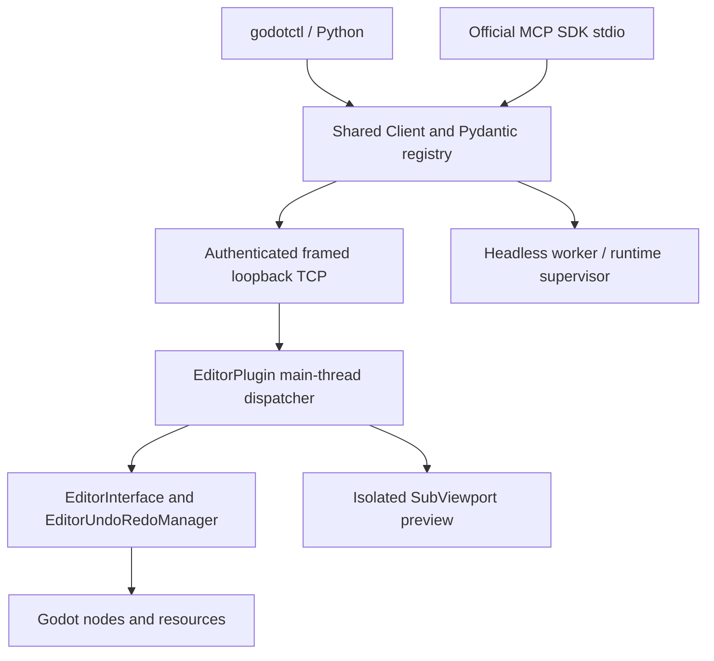

# Architecture

Python and the engine independently validate the shared operation schema. CLI
adapters translate arguments; MCP schemas come directly from the same models.
The editor is authoritative for all live scene mutations.

Polling reads/writes at most 64 KiB per client per frame. Limits: eight clients,
32 queued requests, one active operation. All Godot operations execute on its
main thread. Scene switches and captures yield to the SceneTree. Network reads
never wait for an incomplete frame.

Node actions use per-scene undo history, explicit ownership, and do/undo references
for lifetime management. Primitive/material/collision creation is one action.
Cross-command transactions are not implemented. Scene creation and saves are
filesystem operations and are not undoable file operations.

Undo/redo accesses the public active-scene history. Godot cautions that direct
history access can affect stability; operations are restricted to the active
scene and rejected during commits. This history includes human editor changes.

Scripts: the editor runs non-`@tool` scripts as placeholder instances (no setters,
`_ready` or `_process`), so those nodes are editable and their exported variables
are listed via `Script.get_script_property_list` (since
placeholders omit `PROPERTY_USAGE_SCRIPT_VARIABLE`). `@tool` scripts really run
and need the per-request `allow_tool_script` opt-in. Duplicate uses all
`Node.DUPLICATE_*` flags (scripts, signals, groups, instancing).

Instances: a scene instance is one node owned by the edited root; its internals
are owned by the instance root and `_own` never adopts them, so saved scenes
contain only the instance entry plus overrides. `node.instantiate` uses
`PackedScene.GEN_EDIT_STATE_INSTANCE` with an undoable attach, rejecting self or
transitive recursion via `ResourceLoader.get_dependencies`. Property edits inside
an instance require `Node.is_editable_instance` on the owning instance root.
Nested-instance internals stay read-only.

Inherited scenes: `Node.get_scene_inherited_state()` is not exposed to scripts, so
base-scene membership comes from the edited scene's saved file. Its PackedScene
(`CACHE_MODE_IGNORE`) yields `SceneState.get_base_scene_state()`; node paths of the
whole base chain form the inherited set, cached per root instance id and file
fingerprint (mtime and size). A path in the set is inherited even if the node was
derived-only, and if a base file changes after first use, or the file cannot be
loaded, every node counts as inherited (reopen the scene). Unsaved scenes have no
file and are treated as not inherited. Inherited nodes accept overrides and new
children; delete, rename, reparent and duplicate are rejected.

Paths are root-relative and change after renames/reparenting. String `instance_id`
preserves 64-bit precision but is session-only, not a persistent GUID. Scene tree
inspection is limited to 10,000 nodes; meshes include local/world AABBs.

## Three kinds of image

- **Editor viewport:** public 3D viewport texture, possibly containing grid and
  gizmos. Native size is reported; the image can be resized to requested dimensions.
- **Auxiliary preview:** an isolated World3D/SubViewport with newly constructed
  mesh/light nodes and read-only mesh/material references. Scene scripts are not
  instantiated. Skinned/scripted meshes are skipped with warnings. Standardized
  environment lighting replaces the scene environment. Gameplay, animation,
  particles and postprocessing are omitted. A separate Camera3D controls framing.
- **Runtime viewport:** the actual Window texture of a bridge-managed game.
  Includes runtime changes and requires a graphical managed run.

Idle editors may not emit `frame_post_draw`; capture yields for scene updates and
uses public `RenderingServer.force_draw(false)` on the main thread. GPU readback
and PNG encoding can briefly occupy that thread. Preview nodes are freed after
capture. Abandoned captures can remain under `.godot/godotbridge/captures`.

Snapshots check scene path/revision changes and report `partial` if detected.
This is a consistency check, not a lock on human edits or external tool scripts.

## Worker processes

Validation loads saved scenes/resources and parses scripts. Scene smoke tests
instantiate off-tree then free instances: `_init` can execute, `_ready` does not.
Use trusted projects. The runner does not save scenes/resources; Godot's caches
and logs can still write under the project. C# compilation is not implemented.

A detached supervisor owns each managed game's Popen handle and bounded stdout/
stderr. Stop requests go to that supervisor; no CLI command kills a stored PID.
A custom SceneTree loads a saved scene and handles runtime capture. Projects with
custom main loops require editor play mode. Managed `user://` data/settings are
isolated under `.godot/godotbridge/worker-user`, separate from normal player saves.
The runner adds no scene or export dependency.

Editor play uses public play/stop APIs.

## Editor-play debugger integration

Two cooperating parts use Godot's supported debugger message channel (prefix
`godotbridge`):

- `runtime/bridge_runtime.gd` is an autoload (`GodotBridgeRuntime`) that the plugin
  registers in `project.godot` on enable, and re-adds on load if it is missing
  (installs enabled before it existed). It is inert when `Engine.is_editor_hint()`
  or `EngineDebugger.is_active()` is false, which covers exported builds and
  bridge-managed runs (it loads there but does nothing). When active it installs an
  `OS.add_logger` Logger that only queues entries under a mutex (logger callbacks may
  come from any thread and must not log themselves; the queue holds 2,000 entries,
  oldest dropped and counted) and flushes up to 200 per frame from the main thread with
  `EngineDebugger.send_message("godotbridge:log", ...)`.
- `debugger_plugin.gd` is an `EditorDebuggerPlugin` added with `add_debugger_plugin`.
  It captures `godotbridge:*` messages into a 5,000-entry ring with monotonically
  increasing sequence numbers and inserts `run_started`/`run_stopped` entries from the
  session signals so clients can separate runs.

Runtime inspection uses the same channel in the other direction. The plugin sends
`godotbridge:<command>` with `[request id, params]` through the active
`EditorDebuggerSession`; the autoload registers `EngineDebugger.register_message_capture`
and answers with `godotbridge:reply`, which `_capture` matches to the awaiting
request (the dispatcher is already awaitable; five-second timeout). The game side
(`runtime/runtime_inspector.gd`) reuses `codec.gd` for the property allowlist and
typed values, resolves paths like `node_manager.resolve`, and bounds trees at 5,000
nodes. Verified empirically: captures are still serviced while the game is stopped
at a breakpoint, and the autoload also loads (inertly) in the managed runtime.

This is distinct from managed-runtime stdout capture, which reads the supervised
process's pipes and needs no debugger.

## Breakpoints, stack and variables (not implemented)

Godot's editor runs a Debug Adapter Protocol server (default `127.0.0.1:6006`).
A stateless client (connect, request, disconnect per CLI call) was evaluated and is
not reliable on 4.7.2: closing the connection leaves the game running and breakpoints
set through `setBreakpoints` persist, but the server keeps global per-break state.
After one client has called `scopes`/`variables`/`evaluate` (or stepped), a fresh
connection's `stackTrace` returns no frames, and `stepOut`/`stepIn` can leave the
connection unanswered. See PROGRESS.md for the details and the proposed alternative.

## Version-matched references

- [EditorInterface 4.7](https://docs.godotengine.org/en/4.7/classes/class_editorinterface.html)
- [EditorUndoRedoManager 4.7](https://docs.godotengine.org/en/4.7/classes/class_editorundoredomanager.html)
- [Node 4.7](https://docs.godotengine.org/en/4.7/classes/class_node.html)
- [SceneState 4.7](https://docs.godotengine.org/en/4.7/classes/class_scenestate.html)
- [RenderingServer 4.7](https://docs.godotengine.org/en/4.7/classes/class_renderingserver.html)
- [TCPServer 4.7](https://docs.godotengine.org/en/4.7/classes/class_tcpserver.html)
- [Crypto 4.7](https://docs.godotengine.org/en/4.7/classes/class_crypto.html)
- [Command line 4.7](https://docs.godotengine.org/en/4.7/tutorials/editor/command_line_tutorial.html)
- [Official MCP Python SDK](https://github.com/modelcontextprotocol/python-sdk)
