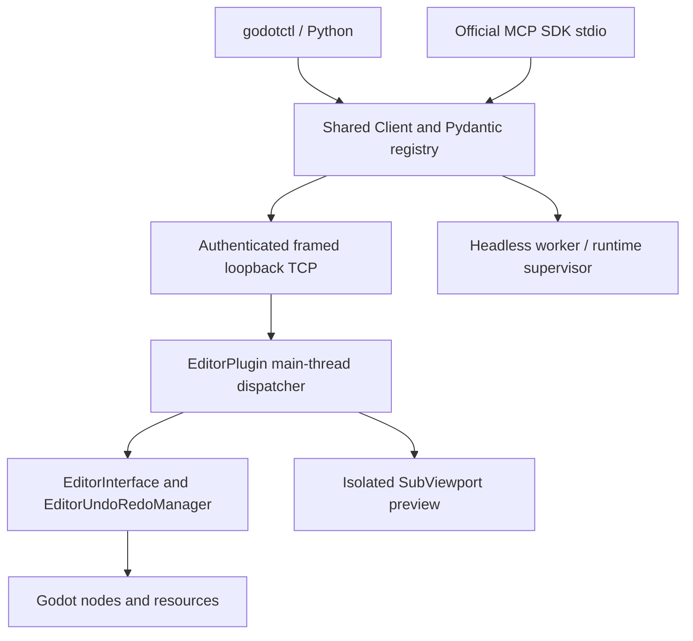

# Architecture

Python and the engine independently validate the shared operation schema. CLI
adapters translate arguments; MCP schemas come directly from the same models.
The editor is authoritative for all live scene mutations.

Polling reads/writes at most 64 KiB per client per frame. Limits: eight clients,
32 queued requests, one active operation. All Godot operations execute on its
main thread. Scene switches and captures yield to the SceneTree. Network reads
never wait for an incomplete frame.

Node actions use per-scene undo history, explicit ownership, and do/undo references
for lifetime management. Primitive/material/collision creation is one action.
Cross-command transactions are not implemented. Scene creation and saves are
filesystem operations and are not undoable file operations.

Undo/redo accesses the public active-scene history. Godot cautions that direct
history access can affect stability; operations are restricted to the active
scene and rejected during commits. This history includes human editor changes.

Scripts: the editor runs non-`@tool` scripts as placeholder instances (no setters,
`_ready` or `_process`), so those nodes are editable and their exported variables
are listed via `Script.get_script_property_list` (since
placeholders omit `PROPERTY_USAGE_SCRIPT_VARIABLE`). `@tool` scripts really run
and need the per-request `allow_tool_script` opt-in. Duplicate uses all
`Node.DUPLICATE_*` flags (scripts, signals, groups, instancing).

Paths are root-relative and change after renames/reparenting. String `instance_id`
preserves 64-bit precision but is session-only, not a persistent GUID. Scene tree
inspection is limited to 10,000 nodes; meshes include local/world AABBs.

## Three kinds of image

- **Editor viewport:** public 3D viewport texture, possibly containing grid and
  gizmos. Native size is reported; the image can be resized to requested dimensions.
- **Auxiliary preview:** an isolated World3D/SubViewport with newly constructed
  mesh/light nodes and read-only mesh/material references. Scene scripts are not
  instantiated. Skinned/scripted meshes are skipped with warnings. Standardized
  environment lighting replaces the scene environment. Gameplay, animation,
  particles and postprocessing are omitted. A separate Camera3D controls framing.
- **Runtime viewport:** the actual Window texture of a bridge-managed game.
  Includes runtime changes and requires a graphical managed run.

Idle editors may not emit `frame_post_draw`; capture yields for scene updates and
uses public `RenderingServer.force_draw(false)` on the main thread. GPU readback
and PNG encoding can briefly occupy that thread. Preview nodes are freed after
capture. Abandoned captures can remain under `.godot/godotbridge/captures`.

Snapshots check scene path/revision changes and report `partial` if detected.
This is a consistency check, not a lock on human edits or external tool scripts.

## Worker processes

Validation loads saved scenes/resources and parses scripts. Scene smoke tests
instantiate off-tree then free instances: `_init` can execute, `_ready` does not.
Use trusted projects. The runner does not save scenes/resources; Godot's caches
and logs can still write under the project. C# compilation is not implemented.

A detached supervisor owns each managed game's Popen handle and bounded stdout/
stderr. Stop requests go to that supervisor; no CLI command kills a stored PID.
A custom SceneTree loads a saved scene and handles runtime capture. Projects with
custom main loops require editor play mode. Managed `user://` data/settings are
isolated under `.godot/godotbridge/worker-user`, separate from normal player saves.
The runner adds no scene or export dependency.

Editor play uses public play/stop APIs. Full debugger introspection, breakpoints,
remote live-node access and editor log streaming are future work.

## Version-matched references

- [EditorInterface 4.7](https://docs.godotengine.org/en/4.7/classes/class_editorinterface.html)
- [EditorUndoRedoManager 4.7](https://docs.godotengine.org/en/4.7/classes/class_editorundoredomanager.html)
- [Node 4.7](https://docs.godotengine.org/en/4.7/classes/class_node.html)
- [SceneState 4.7](https://docs.godotengine.org/en/4.7/classes/class_scenestate.html)
- [RenderingServer 4.7](https://docs.godotengine.org/en/4.7/classes/class_renderingserver.html)
- [TCPServer 4.7](https://docs.godotengine.org/en/4.7/classes/class_tcpserver.html)
- [Crypto 4.7](https://docs.godotengine.org/en/4.7/classes/class_crypto.html)
- [Command line 4.7](https://docs.godotengine.org/en/4.7/tutorials/editor/command_line_tutorial.html)
- [Official MCP Python SDK](https://github.com/modelcontextprotocol/python-sdk)
